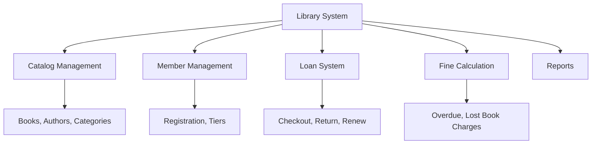

# 📚 Library Management System

<div align="center">


**Complete Library Management with OOP Principles**

[]()
[](https://github.com/samalarakshithbabu/library-management-system/issues)

</div>

---

## 🚀 Executive Summary

A **complete library management system** demonstrating all 4 OOP pillars (Encapsulation, Inheritance, Polymorphism, Abstraction) with MySQL integration. Features book/member management, loan tracking, and reporting.

### What It Does



---

## ✨ Key Features

| Feature | Description |
|---------|-------------|
| **Book Catalog** | Multiple copies tracking, ISBN, authors |
| **Member Management** | Registration, tiers, status tracking |
| **Loan System** | Checkout, return, renewals, reservations |
| **Fine Calculation** | Automatic overdue fines |
| **Search** | Full-text search and filters |
| **Reports** | Circulation stats, popular books |

---

## 🛠️ Technology Stack

| Layer | Technology | Purpose |
|-------|------------|---------|
| **Backend** | Java (Spring) / Python (Flask) | Business logic |
| **Frontend** | React / Thymeleaf | User interface |
| **Database** | MySQL / PostgreSQL | Data persistence |
| **Auth** | JWT / Session RBAC | Security |

---

## 📁 Project Structure

```
library-management-system/
├── backend/
│   ├── models/              # Book, Member, Loan, Fine
│   ├── routes/              # API endpoints
│   ├── services/            # Business logic
│   └── main.py / Application.java
├── frontend/
│   ├── src/
│   │   ├── components/
│   │   ├── pages/
│   │   └── services/
│   └── package.json / pom.xml
├── database/
│   ├── schema.sql
│   └── seed_data.sql
├── tests/
└── README.md
```

---

## 🛠️ Installation

### Python Backend
```bash
cd backend
pip install -r requirements.txt
python init_db.py
python main.py
```

### Frontend
```bash
cd frontend
npm install
npm start
```

---

## 📊 Database Schema

| Table | Description |
|-------|-------------|
| **books** | Catalog with copies tracking |
| **authors** | Author information |
| **categories** | Book categories |
| **members** | Member registration |
| **loans** | Checkout/return records |
| **fines** | Fine tracking |

---

## 📄 License

This project is licensed under the MIT License.

---

## 👨‍💻 Author

**SAMALA RAKSHITH BABU**

- 📧 Email: samalarakshithbabu7@gmail.com
- 💼 LinkedIn: [samala-rakshith-babu](https://www.linkedin.com/in/samala-rakshith-babu/)
- 🐙 GitHub: [samalarakshithbabu](https://github.com/samalarakshithbabu)